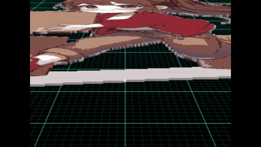
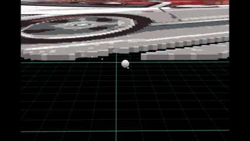
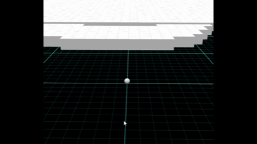
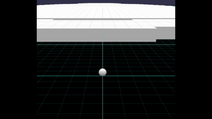
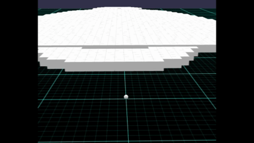
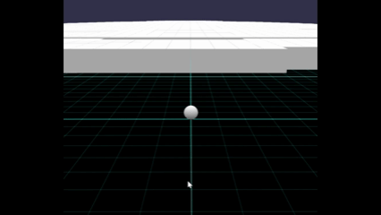
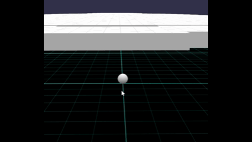
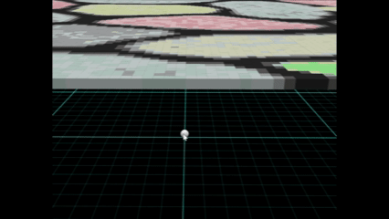

# Babylon.js で物理演算(Havok) ：画像のブロックをふっ飛ばす

## この記事のスナップショット

  
*sample (6倍速)*

  
*sample2 (16倍速)*

https://playground.babylonjs.com/?BabylonToolkit#8A4YVE

（上記のURLにおいて、ツールバーの歯車マークから「EDITOR」のチェックを外せばウィンドウいっぱいに、歯車マークから「FULLSCREEN」を選べば画面いっぱいになります。）

[ソース](172/)

ローカルで動かす場合、上記ソースに加え、別途 git 内の [136/js](https://github.com/fnamuoo/webgl/tree/main/136/js) を ./js として配置してください。

## 概要

大量のブロック（物理オブジェクト）の検証がてら、ショートゲームにしてみました。
試行錯誤していたものをまとめたので、作り込みが甘い点はご了承ください。

第○回目の吹っ飛ばし系ゲームです。

以前作った
- [Babylon.js で物理演算(Havok) ：ジャンプ・ゴルフ](https://zenn.dev/fnamuoo/articles/5c4eeee5e6c597)

を応用して、ボールを飛ばしてブロックを弾き飛ばします。

ブロックをただ吹っ飛ばすことだけを楽しむゲームです。（クリア判定がないので、手動でステージ切り替えが必要）

今回画像をもとにブロックを作っており、画素に対応した色ブロックを並べてます。
ThinInstance で軽量化していますが、それでも（当環境では）Havokを使っている関係上 100x100で動きがぎこちなくなり、256x256でコマ送りで動くようになり、500x500だと表示すらままならない状況でした。
（Havokを使わないMeshだけなら 500x500でも余裕ですが。）

関連リンク

- [Babylon.js：ブロック消しゲーム](https://zenn.dev/fnamuoo/articles/0c95866210d775)
- [Babylon.js で物理演算(Havok)：タワーディフェンスのゲームをつくる](https://zenn.dev/fnamuoo/articles/2ea0f9fb5b0f8f)
- [Babylon.js で物理演算(Havok) ：FPSゲーム２（手探り中）](https://zenn.dev/fnamuoo/articles/5b32f78657df90)
- [Babylon.js で物理演算(Havok) ：FPS3（微改修）](https://zenn.dev/fnamuoo/articles/99b7bfd7af8bcd)

## 遊び方

### プレイ方法

ボールを掴んで・タップしたまま、手前に引っ張って、離すだけです。

  
*sample*

### パワーを変更して打ち出す

以下のアイコンを切り替えることで、パワーを強くできます。

ボールを飛ばすパワーを変化させます。1倍、1.5倍、2倍、4倍から選ぶことができます。

  
*パワーアイコン*

  
*パワー1.5倍時*

パワーは引っ張る長さに比例するので、ズームアウトしてより長く引っ張れば、パワーを変えずとも強く打ち出せます。

  
*ズームアウトして引っ張る (4倍速)*

### 特殊効果で吹っ飛ばす

１つ１つピンポイントで吹っ飛ばすのは地味で面倒なので、
まとめて飛ばせるよう、特殊効果を設けてます。

  
*特殊効果*

#### 乱射

一定時間、小さな玉を四方八方に飛ばします。
方向はランダムなので、当たればラッキー的なものです。

  
*乱射*

#### 爆発

一定時間、玉を中心とした一定範囲を吹き飛ばす力場を発生させます。

  
*爆発*

## 開発秘話

### 画像から物理ブロックを並べる

画像の画素情報（RGB値）をそのままブロックにして表示させます。

アイコンのサイズでも数百画素、サムネイルで数千～数万画素になるので、効率を考えてThinInstance を使います。
物理ブロックとするために、shape および body を別途定義して割り当てますが、初期状態でスリープ(非アクティブ)状態にしておきます。

### 上手くいっていない点

スリープ状態で最適化したものの、ボールが直近のブロックに衝突した瞬間、
その衝撃が一気に周囲のブロックへと波及して全ブロックがアクティブ化します。
そのため、画素数が大きくなるほど衝突した瞬間に画面がフリーズしたように止まってしまい、
「スリープにしたのが本当に正解だったのか？」と思います。

  
*一瞬止まる様子*

### ゴルフからコード移植

ブロックを吹っ飛ばす仕組みとして、
以前の
- [Babylon.js で物理演算(Havok) ：ジャンプ・ゴルフ](https://zenn.dev/fnamuoo/articles/5c4eeee5e6c597)
を流用しました。

UI(引っ張って、ボールを飛ばすところ）や、パワーアイコンはそのままに、
クラブの選択はやめて、直進（パター）の挙動に統一。
ボールのスピンは変更して、特殊効果（乱射、爆発）に置き換えました。

## まとめ・雑感

ショートゲームとしては、比較的コスパ良く実現できました。
しかし、手段（ブロックを吹っ飛ばすこと）が目的になっているので、
ゲームとしてはコンセプトが不明瞭で、パッとしない出来です。
これなら「ブロックを消したら絵が現れる」 [Babylon.js：ブロック消しゲーム](https://zenn.dev/fnamuoo/articles/0c95866210d775) がゲームとしては面白いかもしれません。

大量のブロックを吹っ飛ばす様は爽快ですが、ちょっと大きな画像で試すとすぐに重くなるのが欠点です。
200x200サイズでもサクサク動いてくれれば言うことなしだったのですが。

このまま大規模化を目指すか、数千オーダーあたりで出来ることを模索するか、悩ましいところです。

------------------------------

前の記事：[Babylon.js ：Crowd Navigation System で人流のテスト](171.md)

次の記事：[Babylon.js：画像フロックを切り崩すゲームを作る](173.md)

目次：[目次](000.md)

この記事には次の関連記事があります。

- [Babylon.js で物理演算(Havok) ：ジャンプ・ゴルフ](170.md)
- [Babylon.js：ブロック消しゲーム](097.md)
- [Babylon.js で物理演算(Hvok)：タワーディフェンスのゲームをつくる](103.md)
- [Babylon.js で物理演算(Havok) ：FPSゲーム２（手探り中）](161.md)
- [Babylon.js で物理演算(Havok) ：FPS3（微改修）](164.md)

--

