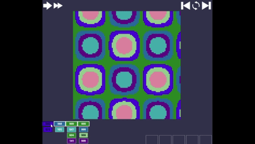
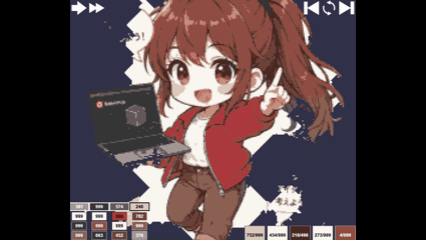
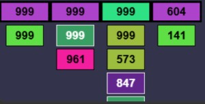

# Babylon.js ：画像ブロックを切り崩すゲームを作る

## この記事のスナップショット

  
*sample (8倍速)*

  
*sample2 (16倍速)*

- [playground](https://playground.babylonjs.com/?BabylonToolkit#BYCIAZ)
  - 上記のURLにおいて、ツールバーの歯車マークから「EDITOR」のチェックを外せばウィンドウいっぱいに、歯車マークから「FULLSCREEN」を選べば画面いっぱいになります。
- [ソース](173/)
  - ローカルで動かす場合、上記ソースに加え、別途 git 内の [136/js](https://github.com/fnamuoo/webgl/tree/main/136/js) を ./js として配置してください。

## 概要

最近、ブロックを崩す系のパズルゲーム(ピクセルアート崩し？)を目にするので作ってみました。
画像がブロックになって、外側から同じ色のブロックを取出し／切り崩していくゲームです。
作ったといっても生成AIに主に働いてもらい、修正や微調整を重ねて完成させました。

## 遊び方

- 左下にバケットのスタックが表示されます。スタックの一番上のバケットを選ぶことができます。
- バケットを選ぶと右下のワークエリアに移動され、バケットと同じ色の画素（ブロック）を画像から取り崩し、バケットに貯めます。
- バケットがいっぱいになったらワークエリアが空いて、次のバケットをスタックから選べます。
- 画像をすべて切り崩せたらクリアです。

- 操作（プッシュ）可能な箇所は以下のとおり
  - 左下のスタック（バケットを選ぶ）
    -   
      *スタック*
  - 左上のスピードボタン（遅い／速いを選択）
    -   
      *スピードアイコン*
  - 右上の（前ステージ、当ステージのやり直し、次ステージ）
    -   
      *コントロールアイコン*

## 開発のプロセス：生成AIを活用したゲーム作り

ゲームルールを作成して、生成AIに入力。
ルールの細部を決めつつ、矛盾を修正することでゲームルールの完成度を高め、
生成AIにサンプルコードを作ってもらいます。

その後、人手で改修を行い、体裁を整えました。

### 生成AIに処理とUIを考えさせる

  - ルールの素案を箇条書きで列挙
    - まずは荒っぽくてもよいので、ルールを書き下します。

    ```md:初期案
    -  ゲームルール
      - 画像（静止画）をピクセル単位のブロックに置き換え。画像の画素の並びそのままに、ブロックを配置する
      - このブロックを全て取り除けば、ゲームクリア
      - ブロックを取り除くには、画素のRGB値（カラーバレット）と同じRGB値をもったバケットを用いる。
      - バケットはRGB値と画素を格納するサイズ（容量）をもつ。
      - バケットにはバケットのRGBと同じ画素（ブロック）のRGB値を入れることができる
      - バケットの容量いっぱいまでブロックを入れると、バケットは消滅する
      - 空のバケットは４列のスタックに並んでおり、スタックの先頭からのみ取り出すことができる
      - バケットはワークエリアに最大５つまで置くことができる
      - ワークエリアのバケットが５未満の場合はスタックの４列のどれかから１つバケットを取出し、ワークエリアに置ける
      - ワークエリアに置いたバケットは、そのバケットと同じRGBを持つブロックをもってこれる
      - 取り崩せるRGBのブロックは一番外側のブロック、四方に隣接するブロックがないブロックは、バケットとRGBが一致する場合に取り出せる。四方を囲まれたブロックは取り出せない。
      - バケットのRGBと容量の総和は、ブロックのRGBとその数の総和と一致する。
      - バケットの容量は99を最大とする
    ```

  - 生成AIに考えさせる(1)：ブラッシュアップする
    - 上記のゲームルールと一緒に下記プロンプトを投げて、生成AIにチェックさせました。
    - 生成AIの回答から、必要な要素、ルールの不備、抜け漏れを確認し、プロンプトを修正しました。

    ```prompt
    babylon.js で、次のゲームの作りを考えて。
    ```

  - 生成AIに考えさせる(2)：アルゴリズムを考えさせる
    - ルールが固まってきたところで実装（製造）における技術的な問題点、実際に解くことのできるゲームかを考えさせます。
    - このゲームでは、スタックのバケットの作り方がミソになります。念のため異なる生成AIのアプローチをみておきます。

    ```prompt
    画像から実際にクリア可能な4列バケットを自動生成するアルゴリズムを考えて。
    ```

  - 生成AIに考えさせる(3)：試作品（サンプル）を作成
    - 各フェーズでの回答をもとに、ゲームルールをさらにブラッシュアップ
    - プログラミング言語、動作環境を指定して、サンプルを作らせてみます。
    - 下記プロンプトは最終案ですが、それまでにテストプレイも重ねて次のような微調整も行ってます。
      - マウス操作を減らすよう、自動で動くようにルール追加
      - 大きい画像にも対応できるよう ThinInstance を使うようルール追加

    ```md:最終案
    Babylon.js 9 の Playground でそのまま動かせるゲームを考えて
    
    - ゲームルール
      - 画像（静止画）をピクセル単位のブロックに置き換え。画像の画素の並びそのままに、ブロックを配置する
      - このブロックを全て取り除けば、ゲームクリア
      - ブロックを取り除くには、画素のRGB値（カラーバレット）と同じRGB値をもったバケットを用いる。
      - バケットはRGB値と画素を格納するサイズ（容量）をもつ。
      - バケットにはバケットのRGBと同じ画素（ブロック）のRGB値を入れることができる
      - バケットの容量いっぱいまでブロックを入れると、バケットは消滅する
      - 空のバケットは４列のスタックに並んでおり、スタックの先頭からのみ取り出すことができる
      - バケットはワークエリアに最大５つまで置くことができる
      - ワークエリアのバケットが５未満の場合はスタックの４列のどれかから１つバケットを取出し、ワークエリアに置ける
      - ワークエリアに置いたバケットは、そのバケットと同じRGBを持つブロックをもってこれる
      - 取り崩せるRGBのブロックは一番外側のブロック、四方に隣接するブロックがないブロックは外側とし、バケットとRGBが一致する場合に取り出せる。四方を囲まれたブロックは内側とし、取り出せない。
      - バケットのRGBと容量の総和は、ブロックのRGBとその数の総和と一致する。
      - バケットの容量は99を最大とする
      - RGBが同じバケットが複数ワークエリアにあるときは、同じRGBのブロックをどちらかのバケットに入れる。並列処理にして別の場所にある同じRGBのブロックをそれぞれのバケットに入れるように処理してもよい。
      - ワークエリアがバケットでいっぱい（空きがなくバケットが５つ取得済み）で、取り出せるブロックがないときはゲームオーバーとする。
      - ユーザが出来る操作はスタックからバケットを選択できる操作のみ
      - ワークエリアにバケットが配置されたら、自動的に取出し可能なブロックを探し、ブロックを取り出す
      - ThinInstance を使った大規模メッシュ(100x100)に対応できるようにして
      - 画像の例として添付ファイルを使った場合を考慮して
    ```

### 人手による改修・ゲームバランスの調整（苦労した点）

AIが作ったベースコードに対し、人間側で次のような実機テストと調整を行いました。

#### 画像の色数と難易度バランス
- 原色、TRUE COLOR(数千色～数万色)をそのまま利用すると、数個しか現れない色が大量発生して**「○○ゲー」化**することが判明。
- 多色でも12色、グラデーションなら6色程度に抑えないと難度が高すぎます。
- 減色する際は、カラーパレットを最適化する（見た目の感じを損ないにくい）画像ソフト（GIMP v3.2.6等）を用いました。

#### スタックデータのハードコード化
- ランダム生成のスタックだと「絶対に解けないパターン」や「順番依存による詰み」が発生。
- 試行錯誤の末、極端に難しくならないバランスの良いスタックを選んでハードコード化しました。

#### 最適な画像サイズ
- **100px**: 細部が潰れてしまう。
- **500px**: 綺麗に見えるが処理が重くなり、バケットを選ぶ作業が単調で苦痛になる。
- **結論**: **200～300px** あたりが、ディテールとサクサク遊べるテンポのバランスが最も良かったです。

## まとめ・雑感

画像の素材を準備するのは楽しいけど、
UIやアルゴリズムを考えるのは面倒だなぁと少々モチベーションが低めだったのですが、
生成AIが助けてくれました。

最初のルール作成（要件定義）さえできてしまえば、
設計、プロトタイプ作成をすっ飛ばせてしまいました。
プログラミングのありようもずいぶん様変わりです。

------------------------------

前の記事：[Babylon.js で物理演算(Havok) ：画像のブロックをふっ飛ばす](172.md)

次の記事：..


目次：[目次](000.md)

この記事には次の関連記事があります。
