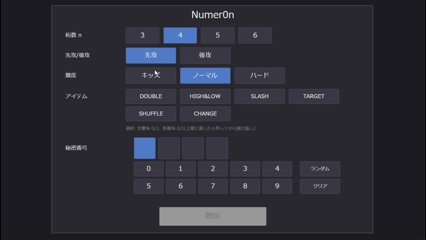

# Babylon.js：AI駆動でつくる Hit&Blow / Numer0n

## この記事のスナップショット

  
*Hit&Blow sample (4倍速)*

  
*Numer0n sample (4倍速)*

## デモ＆ソース

- [Hit&Blow-playground](https://playground.babylonjs.com/?BabylonToolkit#F1I1MC)
- [Numer0n-playground](https://playground.babylonjs.com/?BabylonToolkit#P5OI2X)
  - 上記のURLにおいて、ツールバーの歯車マークから「EDITOR」のチェックを外せばウィンドウいっぱいに、歯車マークから「FULLSCREEN」を選べば画面いっぱいになります。
- [ソース](174/)
  - ローカルで動かす場合、上記ソースに加え、別途 git 内の [136/js](https://github.com/fnamuoo/webgl/tree/main/136/js) を ./js として配置してください。

## 概要

相手が設定した4桁の数字を当てるゲームHit&Blow(英名Bulls&Cows)とアイテムありのNumer0n を 生成AI に作らせてみました。
今回はAI駆動、プロンプトの調整と壁打ちのみで、ゲームを形にした試みの記録です。
利用する生成AI は ChatGPT, Gemini, Claude （すべて無料枠）で、同じプロンプトを各AIに与え、生成されたコードを比較して、最も良かったものを採用しています

- Hit&Blowではゲームルールとサポート機能（素案）を自作したのち、生成AIにゲームルールの矛盾・曖昧な点の確認、ゲーム難度（レベル）の調整や、相手の数字を推測するサポート機能についても検討を重ね、最終的に実装させてみました。
- Numer0nではもっと簡単にゲームルールだけを策定して、生成AIにゲームルールの矛盾・曖昧な点を修正、ゲーム難度の調整、サポート機能の考慮、そして実装を行いました。

ちなみに、内部処理や、相手の数字（秘密セット）を推論するアルゴリズムについては触れません。
また実装（製造）に関する技術は Babylon.js の [GUI](https://doc.babylonjs.com/features/featuresDeepDive/gui/) 機能のみで、そこについても触れません。
あくまで「AIとの対話によるゲーム制作のプロセス」にフォーカスします。


## Hit&Blow 作成の経過

おおざっぱに説明すると下記のような順で作成しました。

1. うろ覚えのゲームルールを箇条書きにする（下記）
2. NET で情報を確認しつつゲームルールを補正
   - アイテムありの（ヌメロン）だと、ルールがややこしくなりそうなので、まずはシンプルな Hit&Blow を対象にする。
   - 4桁のみでは単調すぎる気がしたので他の桁でも遊べるようにしておく。

3. 生成AIで試行錯誤・深掘りする
   - プロンプト例（敵アルゴリズム）：
     >  添付のゲームルールにおける敵（コンピュータ）のアルゴリズムを 2つ以上考えて。

   - プロンプト例2（サポート機能）：
     > ゲームルールを人間が解くときに有効・有用なUIを考えて。
     > 直接的なものや間接的に誘導するものなど複数候補を考えて。

4. テストプレイのためのコード生成
   - プロンプト例3（コード生成）：
     > UIをふくめて、babylon.js version 9 以上 の playground で動くプロトタイプ、サンプルコードを作成して

      - テストプレイして、ノーヒントで相手の秘密セットを推測するのは難しいと実感


5. ブラッシュアップ
   - プロンプト例4（改善案を提案）：
     > 下記のゲームルールにおけるサポート機能について、改良点を提案してください。

     - ここで「情報量」や「エントロピー」という概念が出てきたため、さらに詳しく調べました。理解できてないですが、有用なのはわかります。

       > コールについて、数字の情報量の多さをどのように定義する？

       > 「情報量最大のCALL」  を求める説明、生成AIが解釈できる説明を箇条書きで示して

   - プロンプト例5（改善案を提案）：
     > 下記のゲームルールにおけるサポート機能について、ゲームバランスを見たときの改良点を多面的に提案してください。

   - プロンプト例6（プログラミング言語に合わせたUIの修正）：
     > 下記、ゲーム案をbabylon.js で実装するとき、実現不可能もしくは実現困難な UI に関する記述を指摘、可能なら修正案を考えて。


6. 最終版のコード生成
   - プロンプト例7（コード生成：再）：
     > UIをふくめて、babylon.js version 9 以上 の playground で動くプロトタイプ、サンプルコードを作成して


#### 参考資料：素案

```md:素案
- ゲームルール
    - 0~9の10個の数字から異なる数字をN個選んで、N桁の数値を作成して、相手の数値を当てるゲーム
    - 最初にN桁の数値を用意、相手には隠しておき、こちらからN桁の数値を言って、先に相手の数値を当てたら勝ち
    - ターンごとにN桁の数値を相手になげて、同じ桁の位置に同じ数値があればHIT、桁の位置が違うけれどその数値があればBLOWとし、HIT数とBLOW数を返す
    - 先にHIT数=N、BLOW数=0にできたら勝ち
    - プレイヤーは先攻か後攻かを選べる
    - 敵（コンピュータ）の難易度を３段階（キッズ、ノーマル、ハード）から選べるものとする
        - キッズは、相手の数値が分かっても、相手より先に正解しない
        - キッズでは数ターンごとにヒント（どんな数字が含まれているか、どこに数字があるか）を教える
        - ノーマルでは、ヒントは出さない。
        - ノーマルではたまに間違えながら答える（答えが最短で分かっても、数ターン後に正解する）
        - ハードでは最短で答えを求める
- UI
    - 準備画面とプレイ画面からなる
    - 準備画面のUI案
        - 開始時にN桁の数値を選ぶ準備画面が表示される
        - N桁を変更できる
        - N個の数値を選んで、確定したらプレイ画面に移行する
    - プレイ画面のUI案
        - 先攻が画面左側、後攻が画面右側に表示
            - それぞれ、一番上に自身（相手）が選んだ数値を表示（相手の場合はマスクして表示）
            - 選んだ数値の下に、各ターンで質問した、質問された数値とHIT数、BLOW数を表示する
        - 画面一番下に、相手の数値を考えるためのワークエリアを表示
            - 10行N列のテーブルを表示して、行ごとに同じ数字を並べる
            - セルをクリック（プッシュ）することで、数字の色の（白／灰色）を切り替えられる
            - 列を一括して、数字の色の（白／灰色）を切り替えられる
            - 列の入れ替えが可能とする
            - リセットで、行の並びを戻し、すべての数字の色を「白」にする
```

#### 参考資料：最終案

```md:最終案
## 0. 実装前提（全画面共通）
* 実装環境: Babylon.js v9以上。UIはすべて Babylon.GUI の AdvancedDynamicTexture（フルスクリーンUI）のみで構築し、HTML DOMは使用しない。3Dメッシュは使用せず、シーン背景色の上にGUIだけを表示する。Grid / StackPanel / Rectangle / TextBlock / Button / ScrollViewer のみを使用する。
* 基準解像度: 1280×720（横長）。idealWidth=1280, idealHeight=720 を設定し、以降の座標・サイズはすべてこの基準解像度でのピクセル値とする。
* 許可する操作: コントロールの単純なクリック／タップと、ScrollViewer のスクロール（タッチのドラッグ）のみ。キーボード入力、InputText、ホバー、右クリック、ダブルクリック、長押し、ドラッグ&ドロップ、マウスホイールが必須となる操作は使用しない。
* タップ対象: 最小 40×40、隣接するタップ対象との間隔は 4 以上。
* 状態の表現: 色だけで意味を伝えず、数値・記号・文言を併記する。
* 計算の実行契機: 候補集合の再計算、確率、エントロピー、予習結果は毎フレーム計算せず、各機能に定めた契機でのみ実行する。重い計算（S2B、S6、ハードの敵）は Web Worker、または1回あたり最大8msの分割実行で行い、計算中は「計算中…」を表示する。計算中に入力が変わった場合、古い入力に対する結果は破棄する。
* Babylon.GUI に標準で無いモーダル、ドロップダウン、ツールチップは使用しない。

## 用語定義
* 秘密セット: 各プレイヤーが用意したN桁のセット。
* 候補集合（プレイヤー用）: 敵の秘密セットとして、プレイヤーがこれまで行った全CALLのHIT数・BLOW数と矛盾しないセットの全体。初期状態は重複なしN桁の全セット（件数 10PN: N=2→90, 3→720, 4→5,040, 5→30,240, 6→151,200, 7→604,800）。Uint8Array（要素数=件数×N）で保持する。更新はプレイヤーのCALLの判定結果が確定した直後に1回だけ行う。サポート機能 S1～S6 はすべてこの候補集合を参照する。
* 候補集合（敵用）: プレイヤーの秘密セットに対して敵が持つ候補集合。プレイヤー用とは別に管理する。
* CALL入力欄: プレイ画面にあるN個のセル（各セルは 0～9 または空欄）。
* 数字選択パネル: プレイ画面下部に常時表示する、0～9＋「空欄」の11個のボタン。
* フォーカスセル: 数字選択パネルの入力先として選択中の1セル（CALL入力欄のセル、またはS5スロットのセル）。枠線で強調する。同時に存在するフォーカスセルは1つ。

## 3. サポート機能（各機能を個別にON/OFFできる）
* 共通: 各機能のON/OFFは準備画面で設定する。ONの機能だけがプレイ画面のサポートタブに並び、同時に表示できるのは1タブのみ（4章参照）。難易度が「ハード」の場合、S2A は無効（ON/OFFボタンをグレー表示して押せなくする）、S3A・S4 の確率濃淡は表示しない。
* S1
   * 候補集合の全要素に含まれる数字を「含まれることが確定した数字」、どの要素にも含まれない数字を「含まれないことが確定した数字」とする。
   * 2行で表示する。「確定（含む）: 1, 3」「確定（含まない）: 0, 5, 7」。該当なしは「なし」と表示する。候補集合の更新時に再計算する。
* S2A（キッズ・ノーマルのみ）
   * 候補集合から無作為に最大5件を選び、リスト表示する。抽選は候補集合が更新された時に1回だけ行い、他の操作では再抽選しない。
   * 「残り候補数: n」を、タブの選択に関係なく上部バーに常時表示する（3桁区切り）。
* S2B
   * 評価対象CALLは「候補集合に含まれるセット」とする。
   * 各評価対象CALLについて、候補集合の各要素との (HIT, BLOW) を集計し、結果ごとの発生確率 p から、期待情報量 H = −Σ p·log2(p) を求める（p=0 の項は0）。
   * 候補数 M が 3,000 以下: 全M件を評価対象CALLとし、全M件の候補と比較する（厳密評価）。
   * M が 3,001 以上: 評価対象CALLを候補集合から無作為に300件、比較相手を候補集合から無作為に最大3,000件抽出して近似評価する。画面に「近似値」と表示する。
   * H の降順で最大3件を、「セット（N桁）／期待情報量 x.xxx bit」の形式で表示する。同値の場合はセットの辞書順。
   * 候補集合の更新時に1回だけ計算する。
* S3A
   * 画面に「0」～「9」の数字要素10個と、空の枠（スペーサー）N個を、左から 0,1,…,9,スペーサー×N の初期順で横一列に並べる。並び順はゲーム判定に影響しない、プレイヤー用のメモである。
   * 要素の幅は min(56, floor(700 / (10+N))) 、高さは 72。
   * 並べ替えは2ステップのタップ操作で行う。①移動したい要素（数字またはスペーサー）をタップして選択する（枠線で強調。もう一度タップすると選択解除）。②別の要素をタップすると、選択していた要素をタップした要素の直前へ移動する。「最後尾へ移動」ボタンを列の右に置き、押すと最後尾へ移動する。アニメーションは行わず、即時に再配置する。
   * 難易度が「キッズ」または「ノーマル」の場合、各数字の下に P(d) = 「数字 d を含む候補数」/「全候補数」を小数点以下3桁で表示する。背景色は白（P=0に近い）から濃い青（P=1）への線形補間とし、P>0.6 のとき文字色は白にする。
   * P(d)=0 の数字は、背景を暗いグレー、文字を薄いグレーにする（グレーアウト）。
   * P(d) は候補集合の更新時にだけ再計算する。
* S3B
   * 「0」～「9」の各数字 d について、p = P(d)（数字dを含む候補数 / 全候補数）の2値エントロピー H(p) = −p·log2(p) −(1−p)·log2(1−p) を求める（p=0 または p=1 のとき 0）。
   * 10個のセル（5列×2行、各 130×64）に「数字 d／H(d) x.xxx bit」を表示する。全難易度で有効。候補集合の更新時にだけ再計算する。
* S4
   * 行に「0～9」、列に「第1桁～第N桁」を配置したマトリクスを表示する（行ヘッダー幅56、セル 64×44、列ヘッダー高さ40）。
   * セルの状態は「空欄」「○」「×」「？」。○=「第k桁は数字d」、×=「第k桁は数字dではない」、？=プレイヤー用の印（判定には使わない）。
   * マトリクスの右側（幅200）に、ツールボタン [○入力] [×入力] [？入力] [消去] と、[矛盾チェック] ボタンを縦に並べる。ツールボタンは排他的トグル。押すとそのツールが有効になり、有効なツールをもう一度押すと全ツールが無効になる。
   * ツールが有効な間: セルをタップすると、そのツールの状態（消去なら空欄）に設定する。行ヘッダーをタップするとその行のN個のセルすべて、列ヘッダーをタップするとその列の10個のセルすべてに同じ状態を設定する。
   * ツールがすべて無効の間: セルをタップするたびに「空欄→○→×→？→空欄」と循環する。
   * 難易度が「キッズ」または「ノーマル」の場合、セルの背景色を P(d,k)=「第k桁が数字dである候補数」/「全候補数」の濃淡で表す（S3Aと同じ色の割り当て）。候補集合の更新時にだけ再計算する。
   * 矛盾チェック: ボタンを押したとき、候補集合のうち、すべての○のセル(d,k)について「第k桁=d」、すべての×のセルについて「第k桁≠d」を満たす要素を数える。0件なら矛盾あり。○/×のセルすべてに赤い枠線（太さ3）を付け、「矛盾があります」と表示する（原因の特定はしない）。1件以上なら「矛盾なし」と表示する。赤枠は、いずれかのセルの状態が変わった時、候補集合が更新された時、または次の矛盾チェックの時に消す。
* S5
   * N桁分のセルを持つスロットを5個、縦に並べる（セル 56×56）。各スロットの右に [コール欄へコピー] ボタンを置き、最下部に [矛盾チェック] ボタンを置く。
   * セルをタップするとそのセルがフォーカスセルになる。画面下部の数字選択パネルで数字（または空欄）を押すと、フォーカスセルに入力され、フォーカスは同じスロットの次のセルへ移る（最終セルでは移らない）。重複する数字も入力できる（矛盾チェックで検出する）。
   * 最後にタップしたセルを含むスロットを「選択中スロット」とし、枠線で強調する。
   * [コール欄へコピー]: そのスロットの内容（空欄を含む）を CALL入力欄へ上書きコピーする。CALLは実行しない。
   * 矛盾チェック: スロットごとに次の順で判定し、結果をセルの背景色で示す。
      1. すべて空欄、または空欄が4つ以上: 判定せず、スロットの全セルの背景を黄色にする。
      2. 同じ数字が2つ以上: その数字が入っているセルの背景を赤にし、以降の判定は行わない。
      3. 候補集合に、スロットの入っている桁と一致する要素（空欄は任意の数字を許す）が1件以上ある: 矛盾なし（色を付けない）。0件: 矛盾あり（スロットの全セルの背景を赤）。
   * 背景色は、そのスロットのセルを編集した時、候補集合が更新された時、または次の矛盾チェックの時に消す。原因の特定はしない。
* S6
   * 対象は CALL入力欄の内容のみとする。
   * [予習する] ボタンを押したときだけ計算する。CALL入力欄がN個すべて埋まり、重複が無い場合のみボタンを有効にする。
   * 計算: 候補集合の全要素と対象CALLの (HIT, BLOW) を求め、結果ごとの件数を集計する。
   * 表示（ScrollViewer、1行36）: 「HIT h / BLOW b → 次の候補数 n 件」。HIT降順、同じならBLOW降順。
   * CALL入力欄の内容または候補集合が変わったら、表示済みの予習結果を消す。

## 4. ユーザーインターフェース（UI）仕様
* 準備画面（ゲーム起動時に必ず最初に表示）
   * 桁数N: 「2」～「7」の6個のボタン（単一選択）。初期値は4。Nを変更したらセット入力を空に戻す。
   * 自身のセット: N個のセルと数字選択パネルで入力する（重複不可。重複する数字のボタンは無効化する）。先頭に0も選べる。初期状態は空。
   * 先攻/後攻: 2個のボタン（単一選択）。初期値は先攻。
   * 敵のレベル: 「キッズ」「ノーマル」「ハード」の3個のボタン（単一選択）。初期値はノーマル。
   * サポート機能: S1, S2A, S2B, S3A, S3B, S4, S5, S6 のON/OFFトグルボタン。初期値はすべてOFF。ハード選択中は S2A を無効にする。
   * 「ゲーム開始」ボタン: セットがN個すべて入力済みのときだけ有効。押すとプレイ画面へ遷移する。
* プレイ画面（基準解像度 1280×720 の領域配置）
   * 上部バー（y 0～56）: 左に「第t ターン／あなたは先攻・後攻／難易度」、右に S2A がONのとき「残り候補数: n」。
   * 左履歴列（x 0～280, y 56～720）、右履歴列（x 1000～1280, y 56～720）。
   * 中央（x 280～1000）: サポート領域（y 56～540）、CALL欄の行（y 548～628）、数字選択パネル（y 636～712）。
   * サポート領域の最上部にサポートタブ（ONの機能のみ）を並べ、同時に表示するパネルは1つ。初期表示は最初のタブ。
   * 履歴列の規則: 先攻のCALLを左列、後攻のCALLを右列に表示する。各列は「CALLする側の履歴」を表し、列の最上段には「そのCALLの対象となる秘密セット（相手の秘密セット）」を表示する。
      * プレイヤーが先攻: 左列＝最上段にマスクした敵の秘密セット、その下にプレイヤーのCALLとHIT数・BLOW数。右列＝最上段にプレイヤーの秘密セット、その下に敵のCALLとHIT数・BLOW数。
      * プレイヤーが後攻: 左列＝最上段にプレイヤーの秘密セット、その下に敵のCALLとHIT数・BLOW数。右列＝最上段にマスクした敵の秘密セット、その下にプレイヤーのCALLとHIT数・BLOW数。
      * マスク表示は、N個のセルすべてに「？」を表示すること。ゲーム終了時に解除して実際の数字を表示する。
      * 履歴の1行は、N個の数字セル（各 28×32）と「xH yB」（幅72）で構成する。行の高さは36。各列は ScrollViewer とし、新しい行を追加したら最下部へ自動スクロールする。
   * CALL欄の行: N個のCALL入力セル（56×56）、[CALL] ボタン、[クリア] ボタン。セルをタップするとフォーカスセルになる。数字選択パネルでの入力後、フォーカスは次のセルへ移る。[CALL] はプレイヤーの手番で、N個すべて埋まっていて重複が無いときだけ有効。押すと、CALLを確定して判定を履歴に追加し、CALL入力欄を空に戻す。
   * 敵のCALLは自動で行う。プレイヤーのCALL確定後（またはプレイヤーが後攻でターン開始時）の600ms後に、敵のCALLと判定を履歴に追加する。敵のCALL待ちの間、[CALL] は無効。
   * 終了: 1章の勝敗判定が確定したら、画面中央（480×240）に結果（勝ち／負け／引き分け）と敵の秘密セットを表示する矩形を重ね、背面の操作を受け付けないようにする（isPointerBlocker）。[準備画面へ戻る] ボタンのみ有効。
```

## Numer0n 作成の経過

こちらも「Hit&Blow」と同様に作成しています。

1. wiki からゲームルールを抜粋
2. ゲームルールの不備（曖昧、矛盾）を指摘させ修正

   - プロンプト例8(不備修正）：

     > 下記の文言を生成AIに渡すときのゲームルールとするとき、生成AIにとって曖昧な表現や矛盾な表記になっている箇所を修正して。
     > 修正の文言は、生成AIが解釈しやすい表現に変換して表示して


3. 敵アルゴリズムの調整

   - プロンプト例9(敵アルゴリズム調整）：

     > 下記、ゲームルールにおいて、敵の強さの段階は妥当か？
     > 極端に変化する場合は、なめらかに、段階的になるよう調整して。
     > 修正の文言は、生成AIが解釈しやすい表現に変換して表示して

4. サポート機能を提案させる

   - プロンプト例10(サポート機能）：

     > 下記ゲームルールに対するプレイヤーへのサポート機能を考えて。
     > ただし、UI は babylon.js 9 以上で表現可能な機能に限定して。
     > 提案する内容・修正の文言は、生成AIが解釈しやすい表現に変換して表示して。

5. 製造の可否確認

   - プロンプト例11(製造可否確認）：

     > 下記ゲームルールを babylon.js 9 以上の playground で動作するコードとして実装する場合の
     > 矛盾や曖昧な定義があれば指摘して。
     > 指摘する内容は・修正の文言は、生成AIが解釈しやすい表現に変換して表示して。

6. 最終版のコード生成
    - プロンプト例12（コード生成）：

     > 下記のゲームルールから、babylon.js version 9 以上の playground(javascript) で動く、サンプルコードを作成してください。


## 補足tips

生成AIにコードを作成させると、次のような形式で返されることがあります。
このまま playground にコピペしても動きません。

```js
var createScene = function () {
    ...
}
```

修正の方法として、
下記のように createScene() の先頭に export 宣言を付けるか、
末尾に `export default createScene;` の一文を追記してください。

```js
// 修正案1
export var createScene = function () {
    ...
}
```


```js
// 修正案2
var createScene = function () {
    ...
}

export default createScene;
```

## まとめ・雑感

生成AIからのサポート機能の提案をみて、
数字の絞り込みに関する機能、S2B 最適コール、S3B 数字情報量、S6 予習 といったものは初耳で
なるほどと思いつつ、このゲームって奥が深いなぁと思った次第です。


生成AIが予見していたとおり、サポート機能が高機能なので「ゲームが作業になりかねない」というジレンマはありますが、
そこはプレイヤー次第（自分ルール）で ON/OFF してもらえればよいかなと思います。
しかし生成AIと壁打ちするなかで、「エントロピー」という単語を目にすることになるとは思わず、「温故知新（おんこちしん）」を体感する制作となりました。


ちなみに、閲覧者が **上記のプロンプトを生成AIに与えても同様の結果が得られるとは限らない** ことにご注意ください。というのも生成AIが上記以外の過去履歴を参考にしているためです。
また、敵アルゴリズムやサポート機能を壁打ちしたことで、結果として作成するコードの品質を上げることにつながったのではないかと思ってます。

また、何度もやり直しています。できがよくなかったり、無料枠を使い切ったりして試行錯誤しています。
Hit&Blowならギリギリ作れる感じですが、Numer0nの場合は 1回で完了せずに継続処理（2回目）で完成しました。


------------------------------

前の記事：[Babylon.js：画像フロックを切り崩すゲームを作る](173.md)

次の記事：..


目次：[目次](000.md)

この記事には次の関連記事があります。

--
