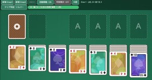
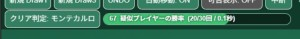

# Babylon.js：AI駆動でつくる ソリティア

## この記事のスナップショット

  
*sample*

## デモ＆ソース

- [playground](https://playground.babylonjs.com/?BabylonToolkit#XYE9FZ#3)
  - 上記のURLにおいて、ツールバーの歯車マークから「EDITOR」のチェックを外せばウィンドウいっぱいに、歯車マークから「FULLSCREEN」を選べば画面いっぱいになります。）
- [ソース](175/)
  - ローカルで動かす場合、上記ソースに加え、別途 git 内の [136/js](https://github.com/fnamuoo/webgl/tree/main/136/js) を ./js として配置してください。

## 概要

カードゲームの「ソリティア」（正式名はクロンダイク）を、生成AIを活用して作成した話題です。

今回は、ゲームルールの策定からコード作成、テストプレイ、アシスト機能の追加まで、プロンプトを調整しながら進めました。

特に、次の点を紹介します。

- ゲームルールの不備や矛盾を生成AIに指摘させる方法
- 仕様を具体化することで、コードの完成度がどう変わったか
- テストプレイで見つかった問題と、その改善方法
- AI駆動開発で役立った工夫と、注意が必要だった点


## 作成手順

### ゲームルールの素案を作成する — ネット検索をもとに基本ルールを整理

ネット検索して、ルールを大まかに整理します。

```md
- ゲームの目的
  - 52枚すべてのカードをマーク（スート）ごとに「A（エース）」から「K（キング）」まで順番に組札（右上）へ積み上げることでクリアとなります。

- カードの配置（初期設定）
  - 場札（7列）: 左から1列目～7列目に、それぞれ1枚～7枚のカードを裏向きに並べます。各列の一番上のカードだけを「表向き」にします。画面中央から下部にレイアウト。
  - 山札: 残りのカードを裏向きにして左上に置きます。
    - 山札から1枚ずつ、または3枚ずつめくるルールがあり、これを変更するとゲームを最初からやり直す（ゲーム途中で切り替えはできない）
  - 組札（4つ）: 右上にマーク別の置き場所を4つ用意します（最初は空欄）。

- 基本ルール・動かし方
  - 場札の重ね方: 表向きのカードは、「赤と黒の交互」かつ「数字が1つずつ小さくなる（降順）」ように重ねることができる。例：赤の8の上に黒の7を置く。
  - 連動した移動: 数字が綺麗に続いているカードの列は、まとめて別の場札へ移動できます。
  - 空いた列のルール: 場札のカードがなくなって空いた列には、「K（キング）」、またはKから始まる一連のカードの束だけが置けます。
  - 裏向きカードのめくり方: 場札の一番上のカードが移動して、下の裏向きカードが露出したら、それを表向きにします。
  - 組札（AからKへ）: 「A（エース）」が出たら組札のスペースに置きます。その後は同じマークで「2、3、4……K」の順番に重ねていきます。
  - 山札の使い方: 山札からカードをめくることができる。めくったカードは表向きにして積み重ね、一番上のカードのみを「場札の重ね方」に従って場札に重ねることができる。
```

### ルールの不備・矛盾を修正する — 生成AIに曖昧な記述や矛盾を指摘させる

ゲームルールの不備と矛盾した項目を修正して、ブラッシュアップします。

```md
ゲームルールの矛盾する点、曖昧な点を指摘・修正して。
修正は生成AIが理解できるトーンで文章を整えて
また変更後の全文をダウンロード可能に
```

### サンプルを作成してテストする — Babylon.js Playgroundで動作を確認

ある程度ルールが収束したら、サンプルを作って、テストプレイして動作確認します。

```md
下記のゲームルールから、babylon.js version 9 以上の playground(javascript) で動く、サンプルコードを作成して
```

### アシスト機能を追加する — プレイ上の課題をもとに支援機能を設計

テストプレイしてみると、（自分のゲームスキルが低すぎて）難しく感じます。
そこでアシスト機能（サポート機能）を考えさせて攻略のレベルを下げます。

```md
ゲームルールを babylon.js 9 以上で実装する想定で、ユーザへのアシスト機能を提案して
提案は生成AIが理解できるトーンで文章を整えて
また変更後の全文をダウンロード可能に
```

提案に基づいて下記機能を列挙して、不備・矛盾を修正してブラッシュアップします。

- 自動組札移動
- カード移動の可否表示
- UNDO機能
- リアルタイムのクリア可能性表示

### 仕様をまとめて実装を仕上げる — ゲームルールと設計を最終プロンプトに統合

ここまでの検討をもとに、ゲームルールと実装に必要な設計をまとめました。

単に遊び方を説明するだけでなく、カードの論理的な順序、移動条件、無効な操作、ゲーム状態、UNDOの扱いまで明確にしています。

全文は長くなりますが、生成AIに実装を任せるうえで、どこまで仕様を具体化したかの参考として掲載します。


```md
# クロンダイク（Klondike）ゲームルール

## 1. 目的

* 52枚のトランプを4つの組札（Foundation）へ移動し、各組札をスートごとにA（エース）からK（キング）まで昇順で完成させる。
* ゲームクリア条件は第12章に定義する。

## 2. カードの定義

### 2.1 スート

52枚のカードには次の4スートがある。

* ハート（Hearts）：赤
* ダイヤ（Diamonds）：赤
* クラブ（Clubs）：黒
* スペード（Spades）：黒

### 2.2 ランク

* カードのランクは次の13種類とする。
  * A、2、3、4、5、6、7、8、9、10、J、Q、K
* ランク比較のための内部値（ランク値）は次のとおりとする。
  * A=1、2=2、3=3、4=4、5=5、6=6、7=7、8=8、9=9、10=10、J=11、Q=12、K=13
* 「1つ小さい」とは、ランク値が1小さいことを意味する。
* 「1つ大きい」とは、ランク値が1大きいことを意味する。
  * 例：8の1つ小さいランクは7、8の1つ大きいランクは9。
  * Aの1つ小さいランク、およびKの1つ大きいランクは存在しない。

## 3. ゲーム領域

* ゲーム画面には、次の4種類の領域を用意する。
* 各領域のカードは順序を持つ。最初に積まれたカードを「先頭」、最後に積まれたカードを「末尾」として管理する（第15章）。

### 3.1 場札（Tableau）

* 7列のカード領域を用意する。
* 左から順に第1列、第2列、第3列、第4列、第5列、第6列、第7列と呼ぶ。
* 各列のカード順序は、先頭から末尾の順で管理する。画面上の上下位置とは無関係に、この論理順序で判定する。

### 3.2 山札（Stock）

* まだ場に公開されていないカードを裏向きで置く領域。
* 画面左上に配置する。
* 山札からカードをめくるときは、山札の末尾カードから1枚ずつ or 3枚ずつ取り出す。

### 3.3 捨て札（Waste）

* 山札からめくったカードを表向きで重ねて置く領域。
* めくったカードは、めくった順番に捨て札の末尾へ積む。
* 捨て札の「一番上のカード」とは、捨て札に最後に積まれたカード（末尾のカード）を指す。
* 捨て札のうち、移動対象にできるのは一番上のカード1枚だけとする。
* 捨て札は、山札の右隣に配置する。

### 3.4 組札（Foundation）

* 4つのカード領域を用意し、画面右上に配置する。
* 初期状態では4領域すべて空である。
* 組札の「一番上のカード」とは、その組札に最後に置かれたカードを指す。
* 空の組札へAを置いた時点で、その組札の担当スートをAのスートに確定する。
* 以後、その組札には同じスートのカードだけを置くことができる。
* 4つの組札の画面上の左から右への並びとスートの対応は固定しない。最初に置いたAによってスートが決まる。

## 4. 初期配置

### 4.1 カード枚数

* トランプ52枚を使用する。ジョーカーは使用しない。
* 各スートについてA～Kを1枚ずつ使用する。

### 4.2 場札の初期配置

* 52枚をシャッフルした後、シャッフル後の並びの先頭から順に、列ごとにまとめて次の枚数を配置する。
  * 第1列：1枚
  * 第2列：2枚
  * 第3列：3枚
  * 第4列：4枚
  * 第5列：5枚
  * 第6列：6枚
  * 第7列：7枚
* 各列では、配置した順に先頭から末尾へ並べる。
* 合計28枚を場札に配置する。
* 各列では、末尾カード（その列に最後に配置した1枚）だけを表向きにする。
* それより先頭側のカードはすべて裏向きにする。

### 4.3 山札の初期配置

* 場札に使用しなかった残り24枚を、シャッフル後の並び順のまま、すべて裏向きにして山札にする。

### 4.4 組札の初期状態

* 4つの組札は空の状態で開始する。

### 4.5 山札のめくり方法の選択

* ゲーム開始時に、プレイヤーが山札のめくり方法を次のどちらかから選択する。
  * 1枚めくり（Draw 1）
  * 3枚めくり（Draw 3）
* この設定はゲーム開始後に変更できない。
* 変更したい場合は、現在のゲームを終了して最初からやり直す。

### 4.6 クリア保証配置

* 52枚をシャッフルし、4.2 および 4.3 のルールに従って初期配置を生成する。
* 生成した初期配置に対して、ゲームルールに準拠したソルバーでクリア可能性を検証する。
  * 自動移動の ON は実施せず、OFF のままで操作する想定
* 52枚すべてを組札へ移動する合法手順が見つかった場合に限り、その初期配置を採用する。
* クリア手順が見つからなかった場合、または探索が制限時間・探索状態数の上限に達して判定不能となった場合は、その配置を採用せず、初期配置の生成からやり直す。
* 生成上限に達した場合は、クリア保証配置の生成に失敗したことを通知する。クリア可能性が確認されていない配置を、クリア保証配置として採用してはならない。

### 4.7 検証条件

* ソルバーは、選択されためくり方式、組札からのカード取り出しルール、および自動組札移動の設定を含め、実際のゲームと同じルールで検証する。
* クリア可能と判定するためには、12.1 のゲームクリア条件に到達する合法手順が必要である。


## 5. カードの表裏状態

* カードには「表向き」と「裏向き」の2状態がある。
* 裏向きカードは、ランクとスートをプレイヤーが確認できない状態で表示する。
* 裏向きカードは、いかなる移動操作の対象にもできない。
* 裏向きカードが表向きになるのは、次の2つの場合だけである。
  * 6.5 の自動表向き化
  * 第8章の山札操作で、カードが捨て札へ置かれるとき
* 表向きカードは、ランクとスートを確認でき、第6章から第9章の条件に従って移動できる。

## 6. 場札から場札への移動

### 6.1 移動できるカード束

* 束は、次の条件をすべて満たすカード列である。1枚だけのカード列も束とみなす。
  1. 束は1列のみにあるカードに限る
  1. 束に含まれるすべてのカードが表向きである。
  2. 束の先頭から末尾の方向に見て、隣接する2枚のランク値が1ずつ減少している。
  3. 隣接する2枚のカードの色が異なる。
* 例：
  * 赤8、黒7、赤6、黒5 は有効な束である。
  * 赤8、赤7 は無効である（隣接カードの色が同じ）。
  * 赤8、黒6 は無効である（ランク値が1ずつ減少していない）。

### 6.2 移動先が空でない場札列の場合

* 移動対象束の先頭カード（束の中でランク値が最大のカード）は、移動先列の末尾カードに対して、次の2条件をどちらも満たさなければならない。
  1. 色が、移動先列の末尾カードの色と異なる。
  2. ランク値が、移動先列の末尾カードより1小さい。
* 条件を満たす場合、移動対象束を移動先列の末尾側へ、順序を保ったまま追加する。
* 例：
  * 赤8の上に黒7を置くことができる。
  * 黒7の上に赤6を置くことができる。
  * 赤8の上に赤7は置けない。
  * 赤8の上に黒6は置けない。

### 6.3 移動先が空列の場合

* カードが1枚も存在しない場札列には、束の先頭カードがK（キング）である移動対象束だけを移動できる。
  したがって、空列へ移動できるのは次のいずれかである。
  * K 1枚
  * Kから始まり、6.2 の条件を満たす束
* 例：
  * 黒K、赤Q、黒J は空列へ移動できる。
  * 赤Q、黒J は空列へ移動できない。
* ただし 6.6 の移動は無効とする。

### 6.4 移動後の処理

* 場札列からカード（束を含む）を他の領域（場札列または組札）へ移動した結果、移動元列の末尾カードが裏向きになっている場合、そのカードを自動的に表向きにする。
* この自動表向き化は、元の移動操作の一部として扱う（16.3 のUNDOでは元の移動操作と同時に取り消す）。

### 6.5 無効とする場札間移動

* 移動元と移動先が同じ列である移動は無効とする。
* 移動対象束が列の全カードである（束の先頭カードが列の先頭カードである）場合に、その束を空列へ移動することは無効とする。ゲーム状態が実質的に変わらないためである。

## 7. 捨て札から場札への移動

* 移動対象にできるのは、捨て札の一番上のカード1枚だけとする。複数枚をまとめて移動することはできない。
* 移動先が空でない場札列の場合は 6.3、空列の場合は 6.4 の条件を適用する（移動対象は1枚なので、そのカードを束の先頭カードとして扱う）。
* 移動後は、捨て札の直下にあったカードが新しい一番上のカードとなる。

## 8. 山札の操作

### 8.1 山札操作の基本

* 「山札操作」とは、プレイヤーが山札領域に対して行う、カードをめくる操作（8.2、8.3）または捨て札を山札へ戻す操作（8.5）を指す。
* 山札のカードを場札や組札へ直接移動することはできない。必ず一度めくって捨て札へ置く。

### 8.2 1枚めくり（Draw 1）

* 山札が1枚以上ある場合、山札の末尾カードを1枚取り出し、表向きにして捨て札の一番上へ置く。

### 8.3 3枚めくり（Draw 3）

* 山札が1枚以上ある場合、山札の末尾から最大3枚を1枚ずつ順に取り出し、取り出した順に表向きで捨て札へ重ねる。
* 最後に取り出したカードが捨て札の一番上のカードとなる。
* 山札の残り枚数が3枚未満の場合は、残っているすべてのカードを取り出す。

### 8.4 山札をめくった直後に操作できるカード

* 捨て札のうち、場札または組札への移動対象にできるのは、捨て札の一番上のカード1枚だけとする。
  * 組札に移動する場合は、カードが 9.1, 9.2 の条件を満たすこと
* 捨て札の一番上のカードを別の領域へ移動した場合、その直下にあったカードが新しい一番上のカードとなり、移動対象になる。

### 8.5 山札が空になった後の再利用

* 山札が0枚で、捨て札が1枚以上ある場合に山札操作を行うと、捨て札を山札として再利用する。次の手順で行う。
  1. 捨て札の全カードの並び順を反転する。
  2. すべてのカードを裏向きにする。
  3. そのまま山札とする（捨て札は空になる）。
* この手順により、再利用後の山札から取り出される順序は、再利用前に捨て札へ積まれた順序と同じになる。
* 再利用の回数に制限はない。
* Draw 1 と Draw 3 の両方で同じ手順を用いる。
* Draw 3 では、再利用後に前回の3枚ごとのまとまりを忘れて、再利用後の山札を対象に、末尾から順に8.3の規則で取り出す。
* 山札が1枚以上ある間は、再利用はできない。
* 山札と捨て札がどちらも0枚の場合、山札操作は無効とする。

## 9. 場札または捨て札から組札への移動

### 9.1 組札へ置ける最初のカード

* 空の組札には、任意のスートのAを1枚だけ置くことができる。
* Aを置いた時点で、その組札の担当スートをAのスートに確定する。

### 9.2 2枚目以降のカード

* 組札にすでにカードがある場合、その組札の一番上のカードと同じスートで、ランクが1つ大きいカードだけを置くことができる。
* 例：
  * ハートAの上にハート2を置ける。
  * ハート2の上にハート3を置ける。
  * ハート2の上にダイヤ3は置けない。
  * ハート2の上にハート4は置けない。

### 9.3 組札へ移動できるカード

* 場札からは、列の末尾カード1枚だけを組札へ移動できる。列の途中のカードや、束を複数枚まとめて組札へ移動することはできない。
* 捨て札からは、末尾のカード1枚だけを組札へ移動できる。
  * 組札に置けるカードは 9.1, 9.2 の条件を満たすこと
* 場札から組札へ移動した後は、6.5 を適用する。

## 10. 組札から他の領域への移動

* 組札の末尾のカードに限り、場札に戻すことができる。
  ただし、空でない列を対象にでき、条件6.3を満たす必要がある。

## 11. 無効な操作

* 第6章から第9章の条件を満たさない操作は、すべて無効とする。
* 次は代表例であり、これら以外でも条件を満たさない操作は無効である。
  * 場札で、移動先列の末尾カードと同じ色のカードを置く（赤の上に赤、黒の上に黒）。
  * 場札で、移動先列の末尾カードよりランク値が1小さくないカードを置く（同じランク、2以上小さいランク、大きいランクのいずれも無効）。
  * 空列にK以外のカードを先頭とする束を置く。
  * 裏向きカードを直接移動する。
  * 場札において、6.2 の条件を満たしていないカード束を移動する。
  * 場札列の途中のカードだけを移動する。
  * 捨て札の末尾以外のカードを直接移動する。
  * 山札のカードを直接移動する。
  * 組札にあるカードに異なるスートのカードを置く。
  * 組札へランクの順序を飛ばしてカードを置く。
  * 組札へ複数枚をまとめて移動する。
  * 6.6 に該当する移動を行う。
* 無効な操作を実行しても、カードの配置、ゲーム状態、UNDO履歴を変更しない。

## 12. ゲームクリア・ゲームオーバー判定

### 12.1 ゲームクリア

* 次の条件をすべて満たした時点でゲームクリアとする。
  1. 52枚すべてが組札へ移動済みである。
  2. 4つの組札がそれぞれ1つのスートのみで構成されている。
  3. 各組札のカード順がA、2、3、4、5、6、7、8、9、10、J、Q、Kである。
* クリア判定は、カードが組札へ移動するたびに行う（自動移動を含む）。
* クリア後は、すべての操作（UNDOを含む）を受け付けない。

### 12.2 ゲームオーバー

* 次のいずれかを満たした時点でゲームオーバーとする。
  * 山札と捨て場にカードが無く、移動できるカードがない場合。
  * プレイヤーがゲームを中断した。
* ゲームクリアの条件を満たしている場合は、ゲームクリアを優先する。
* ゲームオーバー後は、すべての操作（UNDOを含む）を受け付けない。


## 13. 画面レイアウト

* 画面レイアウトは次の相対配置を基本とする。
  * 山札：左上
  * 捨て札：山札の右隣
  * 組札4個：右上
  * 場札7列：画面中央から下部
* カードの具体的なピクセル座標、カード間隔、カードサイズ、アニメーション時間、ドラッグ操作の詳細、クリック操作とドラッグ操作のどちらを採用するかは、本ゲームルールでは定義しない。
* これらはUI実装仕様として別途決定する。

## 14. ゲーム状態として最低限保持する情報

* 生成AIがゲームを実装する場合、少なくとも次の情報をゲーム状態として管理する。
  * 52枚のカードの識別情報（スート、ランク）
  * 各カードの表裏状態
  * 各カードが属する領域（場札の列番号、山札、捨て札、組札の番号のいずれか）
  * 場札7列それぞれのカード順序（先頭から末尾）
  * 山札のカード順序（先頭から末尾）
  * 捨て札のカード順序（先頭から末尾）
  * 組札4個それぞれのカード順序、および各組札の担当スート（未確定、またはスート）
  * 現在のめくり方式（Draw 1 または Draw 3）
  * ゲームの進行状態（プレイ中、ゲームクリア、ゲームオーバーのいずれか）
  * 設定値（自動組札移動のON/OFF、カード移動の可否表示のON/OFF）
  * UNDO用の履歴（直前の1操作の取り消しに必要な、操作前のゲーム状態。取り消せる操作がない場合は空）

## 15. 用語規則

* 生成AI向けの説明では、次の用語を統一して使用する。

### 15.1 カードの位置に関する用語

* 「先頭」「末尾」：各領域において、最初に積まれたカード側を「先頭」、最後に積まれたカード側を「末尾」とする。
* 「列の先頭カード」：場札列で最初に積まれたカード。
* 「末尾カード」：場札列で最後に積まれたカード。場札列の末尾カードは常に表向きである。
* 「露出カード」：場札列において表向きになっているカードすべて。末尾カードだけでなく、列の途中のカードも含む。
  * 末尾カードは露出カードである。
  * 露出カードが末尾カードであるとは限らない。
* 「束の先頭カード」：束のうち最初に積まれたカード。束の中でランク値が最大である。
* 「束の末尾カード」：束のうち最後に積まれたカード。束の中でランク値が最小である。
* 「先頭カード」と単独で記述することは避け、必ず「列の先頭カード」または「束の先頭カード」と記述する。
* 「一番上のカード」：捨て札と組札に限り、最後に積まれたカード（末尾のカード）を指す。
* 「山札の末尾カード」：山札で最後に積まれたカード。山札からめくるときに最初に取り出されるカード。
* 場札では「一番上のカード」「一番下のカード」など、物理的な上下位置と論理的な操作対象が混同する表現を使用しない。

### 15.2 カードの並びに関する用語

* 「束」：6.2 の条件（全カード表向き、隣接カードのランク値が1ずつ減少、隣接カードの色が異なる）を満たすカード列。
* 「ランク」を使用し、「数字」は使用しない。
* 「スート」を使用し、「マーク」は使用しない。
* 「赤と黒の交互」と書かず、「隣接カードの色が異なる」と記述する。
* 「数字が1つずつ小さくなる」と書かず、「隣接カードのランク値が1ずつ減少する」と記述する。

### 15.3 操作に関する用語

* 「移動」：カードまたは束を、別の領域または別の列へ動かすこと。
* 「山札操作」：8.1 で定義する。
* 「操作」：プレイヤーが行う1回の行為。カードの移動（束の移動を含む）または山札操作を指す。
* 「自動移動」：16.1 の機能によってゲームが自動的に行う、捨て札から組札への移動。プレイヤーの「操作」には含めない。
* 「有意手」：12.3 で定義する。

## 16. サポート機能

### 16.1 自動組札移動

* 機能：場札の末尾カードもしくは捨て札の末尾カードが組札へ移動できる場合、そのカードを自動的に組札へ移動する。
* 対象：場札の末尾カードもしくは捨て札の末尾カード
  * 場札の各列の末尾カードは自動移動の対象
  * 山札のカードは直接移動しない（8.1）。山札操作で捨て札の一番上になったカードが対象になる。
* 移動の条件：
  * 場札の末尾カードもしくは捨て札の末尾カードがAの場合、空の組札のうち、画面上で最も左にあるものへ移動する。
  * Aでない場合、組札の一番上のカードと同じスートで、ランク値が1小さい組札が存在するとき、その組札へ移動する。
* 判定のタイミング：プレイヤーの操作が完了するたびに判定する。
  * 場札のカードを移動した場合、6.5 を実施し、末尾カードが表向きになった場合は再度判定を行う。
  * 捨て札の末尾のカードを移動した場合、捨て札の新しい末尾のカードも条件を満たす場合は、条件を満たさなくなるまで繰り返し移動する。
* 自動移動のあとは、12.1 のクリア判定と 12.2 のゲームオーバー判定を行う。
* UNDO直後には、自動移動を実行しない。
* 設定：ゲーム中にON/OFFを切り替えられる。デフォルトはONとする。切り替えた時点で、自動移動の判断を行う。

### 16.2 カード移動の可否表示

* 機能：移動できないカードを、グレー表示（または半透明表示）にする。
* 判定対象：場札の露出カード、および捨て札の一番上のカード。裏向きカード、および捨て札の一番上以外のカードは対象外とし、通常表示のままとする。
* 「移動可能」の定義：そのカードを移動元として選択したとき、第6章から第9章（6.6 を含む）の条件を満たす移動先が1つ以上存在すること。場札の露出カードは、6.2 の束としての移動（束の先頭カードとして選択した場合）と、9.3 の組札への移動を含めて判定する。
* 「移動不可能」なカードだけをグレー表示（または半透明表示）にする。
* この機能は表示だけを変更する。グレー表示のカードを操作しても、ルールに従って判定し、無効なら何も起きない。
* 設定：ゲーム中にON/OFFを切り替えられる。デフォルトはOFFとする。切り替えはUNDO履歴に影響しない。

### 16.3 UNDO機能

* 対象とする「操作」：カードの移動（束の移動を含む）と山札操作（めくる操作、再利用）。無効な操作は含まない。
  * 6.5 の自動表向き化は、元の操作に含める。
* 取り消せるのは、直前の1操作だけとする。UNDO履歴は最大1件とする。
* UNDOを実行すると、その操作の前のゲーム状態（カードの領域、順序、表裏状態）にすべて戻す。組札へ移動したカードも元の位置に戻す（第10章の例外）。
* UNDOを実行した直後は、UNDO履歴が空になり、続けてUNDOすることはできない。
* UNDOを実行した後に、新たに有効な操作を行うと、その操作は再びUNDOの対象になる。
* ある操作の完了後に自動移動（16.1）が1回以上発生した場合、その操作と自動移動はUNDOの対象外とする。このとき、UNDO履歴を空にする（UNDOできない状態にする）。
* ゲームクリア後、およびゲームオーバー後は、UNDOできない。
* めくり方式（Draw 1 / Draw 3）と、16.1・16.2 の設定値はUNDOの対象外であり、UNDOで変更しない。

### 16.4 リアルタイムのクリア可能性表示

* ゲームの進行中において、クリア可能性を指標化する
* リアルタイムで高速に予測させるため、数秒以内に判断すること
* 手法別の提案
  * ソルバ―を用いる場合は、解ける(=0)、解けない(=100)、不明(=unknown)とし、時間内に解けないときは不明とする。
  * モンテカルロ法を使う場合は、数十件程度を限度とすること
* 予測アルゴリズムは、メイン操作とは別に非同期の動作とする
* 推定時は、プレイヤーのゲーム状態とは分けて考え、
  神の視点（場札、山札の配置が全て分かっている状態）としてよい。

## UI

- トランプの裏表の絵柄は、スートごとに複数の画像から使う想定
- ランクごとに、画像の一部を切り抜いて使う想定

- 画面サイズに応じてレイアウトを調整する
- 複数の絵柄を選択可能に、プレイ中に変更可能に
```

このように仕様を具体化したうえで、サンプルコードの作成とテストプレイを進めます。

実際に遊んでみると、ルール以外にも、操作のしやすさや画面サイズへの対応といった課題が見えてきました。

### テストプレイをもとにUIを改善する — 画面サイズに応じたカード配置などを調整

テストプレイをしてみると、カードサイズが固定されているため、デバイスによってはプレイしづらいことが分かりました。
そこで、生成AIに画面サイズに応じたカードサイズと配置の調整を依頼しました。

出来上がったコードを確認すると、メッシュ自体のサイズを変更するのではなく、カメラの設定で表示サイズを調整していました。
こんな方法もあるんですね。勉強になります。


```md
添付のコードについて、画面のサイズに応じて、カードの大きさや配置が適切になるように調整して。
```

```js
// カード表示を調整するソースコード
camera.orthoLeft = -Wv * 0.7 * 0.5; // カメラをズームさせてカードを大きく見せる
camera.orthoRight = Wv * 0.7 * 0.5;
camera.orthoTop = CH / 2 + padTop + sc * barPx*0.7; // 上段のカードの上端がツールバーの padTop 下に来る
camera.orthoBottom = camera.orthoTop - sc * h*0.7;
```

## カードの絵柄を作成

おまけでトランプの絵柄を生成AIで作成させた時のプロンプトを紹介します。

下記の添付とは
[Babylonさん（仮）](https://scrapbox.io/babylonjs/Babylon%E3%81%95%E3%82%93%EF%BC%88%E4%BB%AE%EF%BC%89)
にあるキャラクター設定シートのことです。

```md
添付の画像をもとに、
トランプの絵柄（ハートの1からK）とジョーカーを考えて。各カードのサイズは同じ大きさにそろえて。 
ただし、キャラクターを使うときはヘアカラーを赤く、服も赤っぽいものに変更して。キャラクターのポーズも過去のものとかぶらないように変更して。
```

  
*トランプの絵柄*


## AI駆動開発を振り返る

前回の
[Babylon.js：AI駆動でつくる Hit&Blow / Numer0n](174.md)
ときは、試行錯誤している感はありましたが、
今回は前回の経験を踏まえてより洗練された感じになりました。
生成AIの性能が上がったのか、作られたコードがそのまま動くようになった一方で、
プロンプトの準備（要件定義や設計）が面倒です。

高精度なモデルなら曖昧な指定でも忖度してくれるかもしれませんが、
無料枠のモデルを使っているので、まぁ出来る範囲でやるしかないですね。

なので、モデル自身に不備・矛盾を指摘させ、
「生成AIが理解できるトーン」でアウトプットさせたのがよかったように思います。

それでも人の目で改めて確認しないと、勝手に判断して書き換えてくる場合があるので
再確認は必須で、それがまた面倒だったりしますが。

結果、上述のような緻密なゲームルール＋設計（プロンプト）が出来上がってます。


### 生成AIによる仕様レビューの注意点

『Babylon.jsで実装する想定で、説明が曖昧な点、不備を指摘』させると、
モデルごとに利用するライブラリ(Babylon.js)の理解が異なるのか、
生成AIによって違うことを言ってきたり、細かすぎるところ（レイアウトや色）まで決めてくることがありました。
結果カットしましたが、複数のモデルに問い合わせ・比較させたいときは注意が必要です。
１つのモデルしか使わないなら気にしなくても良いかもですが。

### 長いタスクを分割して実行する

Claudeでのサンプルコード作成時、無料枠を使い切ってしまい、1回 continue しました。
無料枠で使い切ったあとの利用時、Claudeだと継続できるようですが、他の生成AIモデルだとそんな機能がなく、処理が途中で止まる（フリーズ）することもあるようです。

今回は、サポート機能を検討し始めたあたりから長考するようになってきました。


一応下記プロンプトで分割処理することができました。
（別の題材で実験したので、この「ソリティア」でも同様に動作するかは不明です）

```md
下記のゲームルールから、babylon.js version 9 以上の playground(javascript) で動く、サンプルコードを最終的に作成するために、
無料枠で作成できる範囲でタスクを分割して実行することは可能ですか？
各フェーズの結果として、直近のタスクの結果と次のタスク（プロンプト）をダウンロードできるようにして欲しい。
```

## まとめ・雑感

サポート機能を調べているときに、ソルバーやモンテカルロ法でゲームを解く方法があることを知りませんでした。

プレイ中の状態からクリアの可否を判断できるのか半信半疑でしたが、関連する研究や解法を見つけてくれました。理論はさっぱり理解できていないですが、悪手が一目で分かるので、ゲームを解きやすくなりました。

  
*プレイ中のクリアの可否（モンテカルロ）*


今回の開発を通して、生成AIに実装を任せる場合は、ゲームルールや設計を具体化することが重要だと感じました。生成AI自身に不備や矛盾を指摘させ、「生成AIが理解できるトーン」で修正させる方法も有効でした。

一方で、生成AIが独自に判断して仕様を書き換える場合もあるため、人の目による再確認は欠かせません。仕様の準備や確認に手間はかかりますが、その工程も含めてAI駆動開発なのだと思います。


------------------------------

前の記事：[Babylon.js：AI駆動でつくる Hit&Blow / Numer0n](174.md)

次の記事：..


目次：[目次](000.md)

この記事には次の関連記事があります。

- [Babylon.js：AI駆動でつくる Hit&Blow / Numer0n](174.md)
- [Babylon.js：AI駆動でつくる ソリティア](175.md)

--
