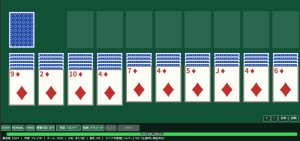
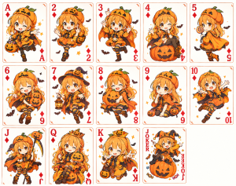

# Babylon.js：AI駆動でつくるスパイダーソリティア

## この記事のスナップショット

  
*sample*

## デモ＆ソース

- [playground](https://playground.babylonjs.com/?BabylonToolkit#41Q0YM#6)
  - 上記のURLにおいて、ツールバーの歯車マークから「EDITOR」のチェックを外せばウィンドウいっぱいに表示し、歯車マークから「FULLSCREEN」を選べば全画面表示になります。
- [ソース](176/)
  - ローカルで動かす場合、上記ソースに加え、別途 git 内の [136/js](https://github.com/fnamuoo/webgl/tree/main/136/js) を ./js として配置してください。


## 概要

前回はソリティア（クロンダイク）を作成しましたが、「トランプの絵柄を楽しむならスパイダーソリティアもよいのでは」と思い、今回はスパイダーソリティアを作成します。

作り方は前回同様、AI駆動開発です。ただし今回は一度作成したコードをベースに、必要な機能を追加・改修していく点が異なります。

ゲームルールの策定には ChatGPT、Gemini、Claude を使用し、コード生成とその後のブラッシュアップには Claude、画像生成には ChatGPT を使用しました。

また、前回のソリティアとの差別化として、別の絵柄を用意しました。

  
*sample2*

今回の記事では、ゲームの実装に加え、リアルタイムのクリア可能度表示、カード画像の利用、ズーム・パン、ゲーム難易度の調整など、実際に機能を追加していった過程を紹介します。


## プロンプト例

### 曖昧さ・矛盾の修正

```md
下記添付のゲームルール「スパイダーソリティア」に矛盾する点があれば指摘・修正して。
修正は生成AIが理解できるトーンで文章を整えて
また変更後の全文をダウンロード可能に
```

### babylon.js 9 以上で実装する想定で、技術的な製造（実装）の可否を判断

```md
添付のゲームルールを babylon.js 9 以上で実装する想定で、技術的な製造（実装）の可否を判断して。
もし修正案を提案する場合は生成AIが理解できるトーンで文章を整えて。
また変更後の全文をダウンロード可能に
```
### サンプル作成

```md
添付のゲームルールから、babylon.js version 9 以上の playground(javascript) で動く、サンプルコードを作成して
```

### 機能追加：リアルタイムのクリア可能性

```md
上記成果物に対し、
リアルタイムのクリア可能度表示について、
既存のソルバー方式に加えて、モンテカルロ法も追加して実装し、
プレイ中に動的に切り替えられるようにしてください。
```

```md
上記、成果物の
リアルタイムのクリア可能度表示について、
数値だけでなく、グラフバーによる表示も追加してください。
```

### 機能追加：カード模様の画像利用

プロンプトに画像を使うよう書いていたのに、無視されたので、明示して機能追加しました。

```md
上記、成果物について、
カードの模様に、別途URLで指定した画像をカードの裏表に使えるようにもして。
ただし、画像は次の想定で
- スートごとに画像を用意
- １つの画像のなかに A~K の画像がgrid上に配置されている
- 既存の模様も使えて、画像の模様も使えるように
```

用意した画像を使えるようになったのですが、絵柄の周囲にある余白が気になりました。
画像自体を加工するのも面倒なので、画像から絵柄を切り出す際に調整できるよう、指示を加えます。

```md
添付のコードについて
カードの模様にURLの画像を使うところ、
画像内のN行M列に分割された個々のセルを模様に使う際、
更にセル内の一部を切り出してカードの模様に使うようにして
```


### 機能追加：ズーム・パン

カードサイズを大きく見せるとどうしても画面に収まらないので、「ズーム・パン」機能を指定して組み込んでもらいました。

```md
添付のコードについて
ズーム、パン（平行移動）の機能を追加して。
もし ArcRotateCamera を使うなら回転は禁止。
```

### 機能追加：ゲーム難度の調整

テストプレイをしてみると NORMAL と HARD はなかなかクリアできませんでした。そこで、ゲームの難易度を下げられないか、生成AIに相談しました。

```md
添付のコードについて
ゲームレベルの NORMAL, HARD のときに、よりクリアしやすくすることは可能か？
可能なら修正を実施して。
```

その結果、ゲームをクリアしやすくできただけでなく、次の一手を提示するヒントボタンも追加されました。


## 実装のベースとなったゲームルール

ここまで紹介した機能追加とは別に、最初のサンプルコードを作成する際、ゲームルールをまとめたプロンプトを使用しました。
カードの定義、初期配置、移動条件、ゲームクリア判定、サポート機能、UIなどを明文化しています。
以下に、参考として全文掲載します。


```md
# スパイダーソリティア ゲームルール

## 1. 目的

* このゲームは、104枚のトランプを8つの組札（Foundation）に、スートごとにA（エース）からK（キング）まで昇順で完成させることを目的とする。
* ゲームクリア条件は第10章に定める。

## 2. カードの定義

### 2.1 スート

* トランプには次の4スートがある。
    * ハート（Hearts）：赤
    * ダイヤ（Diamonds）：赤
    * クラブ（Clubs）：黒
    * スペード（Spades）：黒
* ゲームレベル（難度）によって使用するスートが異なる。いずれのレベルでも、使用するカードは合計104枚である。
    * EASY：1スートのみ使用する。どのスートを使うかはランダムに決める。A～Kの各ランクを8枚ずつ使用する（13ランク × 8枚 = 104枚）。
    * NORMAL：2スートを使用する。赤のスート1つ（ハートまたはダイヤ）と、黒のスート1つ（クラブまたはスペード）を、それぞれランダムに決める。選ばれた各スートについて、A～Kの各ランクを4枚ずつ使用する（2スート × 13ランク × 4枚 = 104枚）。
    * HARD：4スートすべてを使用する。各スートについて、A～Kの各ランクを2枚ずつ使用する（4スート × 13ランク × 2枚 = 104枚）。
* 同じスート・同じランクのカードが複数枚存在するため、各カードには固有のカードIDを付与し、スートとランクだけでは個々のカードを識別しない。

### 2.2 ランク

* カードのランクは次の13種類とする。
  * A、2、3、4、5、6、7、8、9、10、J、Q、K
* ランク比較のための内部値は次のように扱う。
  * A=1、2=2、3=3、4=4、5=5、6=6、7=7、8=8、9=9、10=10、J=11、Q=12、K=13
* 「1つ小さい」とは、ランク内部値が1小さいことを意味する。
  * 例：8の1つ小さいランクは7、Aの1つ小さいランクは存在しない。

## 3. ゲーム領域

* ゲーム画面には、次の領域を用意する。

### 3.1 場札（Tableau）

* 10列のカード領域を用意する。
* 左から順に第1列、第2列、第3列、第4列、第5列、第6列、第7列、第8列、第9列、第10列と呼ぶ。
* 各列のカードは、奥側（最初に配置された側）から手前側（プレイヤーに近い側）の順に並ぶ。
* 各列の手前側の端にあるカードを「露出カード」と呼ぶ。列が空でない限り、露出カードは常に表向きである。

### 3.2 山札（Stock）

* まだ場に公開されていないカードを裏向きで置く領域。
* 画面左上に配置する。

### 3.3 組札（Foundation）

* 8つのカード領域を用意する。画面右上に配置する。
* 初期状態では8領域すべて空である。
* 各組札には、1スートのA～Kの13枚だけが格納される。組札内のカード順序はA、2、3、…、Kとする。
* 場札で同じスートのK～Aの13枚が完成した時点で、第8章に従い、その13枚が自動的に組札へ移動する。移動先は、左から順に最初の空の組札とする。
* プレイヤーの操作で、場札から組札へ、または組札から場札へカードを移動することはできない。

## 4. 初期配置

### 4.1 カード枚数

* トランプ104枚を使用する。ジョーカーは使用しない。
* ゲームレベルによって各スートの枚数が異なる（2.1 に従う）。
    * EASY：どれか1つのスート（1種）のA～Kを8枚ずつ使用する。
    * NORMAL：赤1種と黒1種のスート（2種）のA～Kを4枚ずつ使用する。
    * HARD：各スート（4種）のA～Kを2枚ずつ使用する。

### 4.2 場札の初期配置

* 104枚をシャッフルした後、場札10列へ次の枚数で配置する。
  * 第1列：6枚
  * 第2列：6枚
  * 第3列：6枚
  * 第4列：6枚
  * 第5列：5枚
  * 第6列：5枚
  * 第7列：5枚
  * 第8列：5枚
  * 第9列：5枚
  * 第10列：5枚
* 合計54枚を場札に配置する。
* 各列では、最後に配置された1枚（露出カード）だけを表向きにする。
* それより奥側に重なっているカードはすべて裏向きにする。
* 「一番上のカード」という曖昧な表現は使用せず、原則として「露出カード」と表記する。

### 4.3 山札の初期配置

* 場札に使用しなかった残り50枚をすべて裏向きにして山札にする。
* 山札は画面左上に配置する。
* 山札の50枚は、10枚ずつ5回に分けて配る（第7章）。

### 4.4 組札の初期状態

* 8つの組札は空の状態で開始する。

### 4.5 クリア保証配置

* 104枚をシャッフルし、4.2 および 4.3 のルールに従って初期配置を生成する。
* 生成した初期配置に対して、ゲームルールに準拠したソルバーでクリア可能性を検証する。
* 104枚すべてを組札へ移動する合法手順が見つかった場合に限り、その初期配置を採用する。
* クリア手順が見つからなかった場合、または探索が制限時間・探索状態数の上限に達して判定不能となった場合は、その配置を採用せず、初期配置の生成からやり直す。
* 制限時間、探索状態数の上限、および再生成の上限回数は、実装時に定数として定義する。
* 再生成の上限回数に達した場合は、クリア保証配置の生成に失敗したことをプレイヤーに通知し、ゲームを開始しない。クリア可能性が確認されていない配置を、クリア保証配置として採用してはならない。

### 4.6 検証条件

* ソルバーは、実際のゲームと同じルールで検証する。具体的には、第6章の場札移動、第7章の山札から配る操作（空列がある場合の扱いを含む）、および第8章の組札への自動移動を、すべて実際のゲームと同じ条件で扱う。
* クリア可能と判定するためには、第10章のゲームクリア条件に到達する合法手順が必要である。

## 5. カードの表裏状態

* カードには「表向き」と「裏向き」の2状態がある。
* 裏向きカードは、ランク・スートをプレイヤーが確認できず、移動操作の対象にできない。
* 表向きカードは、ランク・スートを確認でき、ルールに従って移動できる。

## 6. 場札から場札への移動

### 6.1 移動元

* 移動対象は、プレイヤーが選択した表向きカードを先頭カードとし、そのカードから同じ列の露出カードまでのすべてのカードとする。
  * 選択したカードが露出カードである場合、移動対象はその1枚のみとなる。
  * 選択したカードより手前側にカードが存在する場合、それらも含めて移動対象となる（手前側のカードを残して、選択したカードだけを移動することはできない）。
* 移動対象は、6.2 の条件をすべて満たしていなければならない。満たしていない場合、その選択は無効な操作とする。

### 6.2 移動できるカード束

* 移動対象の束は、先頭カードから露出カードに向かって、次の条件をすべて満たしていなければならない。
  1. 隣接する2枚のランクが1ずつ小さくなっている。
  2. 隣接する2枚が同じスートになっている。
  3. 束に含まれるすべてのカードが表向きである。
* 例1：列の並びが奥側から「…、ハート8、ハート7、ハート6、ハート5」で、露出カードがハート5の場合：
    * ハート5を選択した場合の移動対象は「ハート5」で、有効である。
    * ハート7を選択した場合の移動対象は「ハート7、ハート6、ハート5」で、有効である。
    * ハート8を選択した場合の移動対象は「ハート8、ハート7、ハート6、ハート5」で、有効である。
* 例2：列の並びが奥側から「…、ハート8、ハート7、ハート6、スペード5」で、露出カードがスペード5の場合：
    * スペード5を選択した場合の移動対象は「スペード5」で、有効である。
    * ハート6を選択した場合の移動対象は「ハート6、スペード5」で、スートが異なるため無効である。
    * ハート8またはハート7を選択した場合も、移動対象にスペード5が含まれるため無効である。

### 6.3 移動先が他の場札列の場合

* 移動先の列にカードがある場合、移動対象束の先頭カードは、移動先列の露出カードに対して次の条件を満たさなければならない。
  * 移動対象束の先頭カードのランクが、移動先の露出カードのランクより1小さい。
  * スートは同じでも異なっていてもよい。
* 例：
  * ハート8の上にスペード7を置くことができる。
  * スペード7の上にハート6を置くことができる。
  * ハート8の上にハート7を置くことができる。
  * ハート8の上にスペード6は置けない。
* 移動元と同じ列を移動先にすることはできない。

### 6.4 移動先が空列の場合

* カードが1枚も存在しない場札列には、ランクやスートを問わず、6.1 および 6.2 の条件を満たす移動対象（1枚または束）を置くことができる。
* 例：
  * ハートK、ハートQ、ハートJ は空列へ移動できる。
  * ハート5 を空列へ移動できる。
  * ハートQ、スペードJ は束として空列へ移動できない（6.2 の条件を満たさないため）。

### 6.5 移動後の処理

* 場札列からカード（束を含む）が取り除かれた結果、その列の新しい露出カードが裏向きである場合、そのカードを自動的に表向きにする。
* この処理は、場札から場札への移動の後だけでなく、第8章の組札への自動移動の後にも適用する。

## 7. 山札の操作

### 7.1 山札からカードを配る

* 山札に対する操作は「配る」のみとする。
* 配る操作は1回につき10枚である。山札の先頭のカードから順に、第1列から第10列まで各列に1枚ずつ、表向きにして各列の露出カードの上（手前側）に重ねて配置する。
* 山札が空になるまで、何回でも配ることができる（初期状態の山札は50枚のため、最大5回）。
* 場札に空列が存在していても、配る操作は実行できる。空列にも1枚配る。
* 山札が空のときは、配る操作を実行できない。
* 山札のカードそのものを場札や組札へ直接移動することはできない。

### 7.2 配った直後の扱い

* 山札から配られたカードは、場札のカードとして通常どおり移動対象になる。
* 配った結果、第8章の条件を満たす列が生じた場合は、配る操作の直後に組札への自動移動を行う。

## 8. 場札から組札への自動移動

* 次の条件をすべて満たす列が生じた時点で、その13枚を1つの束として、自動的に組札へ移動する。
  1. 列の手前側の端に、同じスートの13枚が連続して並んでいる。
  2. その13枚は、奥側から順にK、Q、J、10、9、8、7、6、5、4、3、2、A の順である（Kが先頭カード、Aが露出カード）。
  3. 13枚すべてが表向きである。
* 13枚の奥側に、他のカードが存在していてもよい。
* 自動移動の判定は、場札から場札への移動の直後、および山札から配る操作の直後に行う。
* 同時に複数の列が条件を満たした場合は、第1列から順に処理する。
* 組札へ移動した後は、6.5 に従って、元の列の新しい露出カードが裏向きであれば表向きにする。
* プレイヤーが手動で場札から組札へカードを移動することはできない。組札へ移動するのは、この自動移動のみである。
* 組札に移動したカードを、場札へ戻すことはできない（ただし、14.2 のUNDOは例外とする）。

## 9. 無効な操作

* 次の操作は無効とする。
  * 場札から場札への移動で、移動対象束の先頭カードのランクが、移動先の露出カードのランクより「ちょうど1小さい」ものでない場合（同じランク、より大きいランク、2以上小さいランクのいずれも無効）。ただし、移動先が空列の場合は除く。
  * 裏向きカードを直接移動する。
  * 場札において、6.2 の条件を満たしていない束を移動する。
  * 移動元と同じ列を移動先にする。
  * 山札のカードを場札や組札へ直接移動する。
  * 山札が空のときに、配る操作を実行する。
  * 場札から組札へ、または組札から場札へ、プレイヤーが手動でカードを移動する。
* 無効な操作を実行しても、カードの配置やゲーム状態を変更しない。また、UNDO履歴にも記録しない。

## 10. ゲームクリア判定・ゲームオーバー判定

* 次の条件をすべて満たした時点でゲームクリアとする。
  1. 104枚すべてが組札へ移動済みである。
  2. 8つの組札がそれぞれ1つのスートのみで構成されている。
  3. 各組札のカード順がA、2、3、4、5、6、7、8、9、10、J、Q、Kである。
* 次の条件のいずれかを満たしたときはゲームオーバーとする。
    * 山札が空で、有効な移動（第6章の条件を満たす移動）が1つも存在しないとき。
    * 山札が空で、現在の状態から到達可能なすべての状態を探索してもゲームクリアに到達できないことが確定したとき（有効な移動が存在しても、同じ状態を繰り返すだけで進展しない場合を含む）。探索が制限に達して判定不能となった場合は、ゲームオーバーとしない。
    * プレイヤーが中断した場合。

## 11. 画面レイアウト

* 画面レイアウトは次の相対配置を基本とする。
  * 山札：左上
  * 組札8個：右上
  * 場札10列：画面中央から下部
* これらはUI実装仕様として別途決定する。

## 12. ゲーム状態として最低限保持する情報

* 生成AIがゲームを実装する場合、少なくとも次の情報をゲーム状態として管理する。
  * 104枚のカードの識別情報（固有カードID、スート、ランク）
  * 各カードの表裏状態
  * 各カードが属する領域（場札、山札、組札）
  * 場札10列それぞれのカード順序
  * 山札のカード順序
  * 組札8個それぞれのカード順序
  * 現在のゲームレベル（EASY、NORMAL または HARD）
  * ゲーム状態（ゲーム中、ゲームクリア済み、ゲームオーバー）
  * UNDO用の直前1操作分のゲーム状態（最大1件）
  * 14.1 の移動可否表示の設定値（ON/OFF）
  * 選択中のトランプの絵柄（第15章）

## 13. 曖昧表現を避けるための用語規則

* 生成AI向けの説明では、次の表現を統一して使用する。
  * 「カードの一番上」ではなく、場札については「露出カード」を使用する。
  * 「露出カード」は、場札の列の手前側の端にあるカードを意味する。
  * 「上」「下」などの物理的な位置表現は使用せず、「奥側」「手前側（露出カード側）」を使用する。
  * 「数字」ではなく「ランク」を使用する。
  * 「マーク」は使用せず、「スート」を使用する。
  * 移動可能な連続の条件は、「隣接カードのランク値が1ずつ減少し、かつ隣接カードのスートが同じ」と記述する（色の交互ではない）。
  * 「束」は、「選択したカード（先頭カード）から露出カードまで連続する、6.2 の条件を満たすカード列」と定義する。
  * 「先頭カード」は、束の中で露出カードから最も遠いカード（ランクが最大のカード）を意味する。
  * 「場札の一番上のカード」など、物理的な上下位置と論理的な操作対象が混同する表現は避ける。

## 14. サポート機能

### 14.1 カード移動の可否表示

* 場札の表向きカードのうち、移動不可能なカードをグレー表示（もしくは半透明）にする機能。
* 次のいずれかに該当する表向きカードを「移動不可能なカード」とする。
  * そのカードを先頭カードとして選択したときの移動対象が、6.2 の条件を満たさない。
  * 移動対象が 6.2 の条件を満たしていても、移動先となる場札列が存在しない（他の列に、移動対象の先頭カードより1つ大きいランクの露出カードがなく、かつ空列も存在しない）。
* 裏向きカードおよび山札は、この機能の対象外とする（グレー表示しない）。
* ゲーム中にON/OFFを切り替えられ、デフォルトはOFFとする。

### 14.2 UNDO機能

* 対象とする「操作」：カードの移動（束の移動を含む）と山札から配る操作。無効な操作は含まない。
  * 6.5 の自動表向き化、および第8章の組札への自動移動は、元の操作に含める。
* 取り消せるのは、直前の1操作だけとする。UNDO履歴は最大1件とする。
* UNDOを実行すると、その操作の前のゲーム状態（カードの領域、順序、表裏状態）にすべて戻す。組札へ自動移動したカードも元の位置に戻す（第8章の例外）。
* UNDOを実行した直後は、UNDO履歴が空になり、続けてUNDOすることはできない。
* UNDOを実行した後に、新たに有効な操作を行うと、その操作は再びUNDOの対象になる。
* ゲームクリア後、およびゲームオーバー後は、UNDOできない。
* 14.1 の設定値はUNDOの対象外であり、UNDOで変更しない。

### 14.3 リアルタイムのクリア可能度表示

* ゲームの進行中において、現在の状態からのクリア可能度を、0～100の指標（または unknown）として表示する。100はクリアできることが確実、0はクリアできないことが確実な状態を表す。
* リアルタイムで高速に予測させるため、数秒以内に判断すること。
* 手法別の提案
  * ソルバーを用いる場合は、解ける（= 100）、解けない（= 0）、不明（= unknown）とし、時間内に判定できないときは不明とする。
  * モンテカルロ法を使う場合は、試行回数を数十回程度までとし、「クリアできた試行の割合 × 100」を指標とする。
* 予測アルゴリズムは、メイン操作とは別に非同期で動作させる。
* 推定時は、プレイヤーのゲーム状態とは分けて考え、神の視点（場札、山札の配置がすべて分かっている状態）としてよい。
* 予測は、実際のゲームと同じルール（4.6 に準拠）で行う。

## 15. UI

* トランプの絵柄
  * トランプの表面と裏面の絵柄は、スートごとに複数の画像から選んで使う想定とする。
  * 表面は、ランクごとに、画像の一部を切り抜いて使う想定とする。
  * 絵柄は3種類から選択可能にする。プレイ中に変更できるものとする。
* 画面サイズに応じてレイアウトを調整する。
```

## 手動で行った最終調整

生成されたコードの品質が高く、手動での修正は主に次の2点で済みました。

- **画像の設定：** 用意した画像のパスを指定し、絵柄を切り出すパラメータを調整
- **ボタン配置：** 画面下部のボタンの配置とサイズを調整
  - よく使うUNDOボタンを右端に配置し、サイズも大きくする
  - 利用しない中断ボタンを削除

このように、コードの大部分を作り直すのではなく、画像の設定や操作性を中心に仕上げました。


## まとめ・雑感

準備（ルール・設計の策定）には時間がかかりますが、そこを乗り切れば、テストプレイに注力でき、コードの改修も想定どおりに進められました。

今回は、一度作成したコードをベースに、クリア可能度の表示やカード画像の利用、ズーム・パンなど、必要な機能を追加していきました。

コード生成がうまくいった背景には、ゲームの仕様を事前に具体化したことに加え、機能を追加しながら段階的に改善できたこともあると感じます。

生成AIにコードを作成させるだけでなく、テストプレイで課題を見つけ、改善を繰り返すことが大切だと改めて感じました。


------------------------------

前の記事：[Babylon.js：AI駆動でつくる ソリティア](175.md)

次の記事：..


目次：[目次](000.md)

この記事には次の関連記事があります。

- [Babylon.js：AI駆動でつくる Hit&Blow / Numer0n](174.md)
- [Babylon.js：AI駆動でつくる ソリティア](175.md)
- [Babylon.js：AI駆動でつくる スパイダーソリティア](176.md)

--

